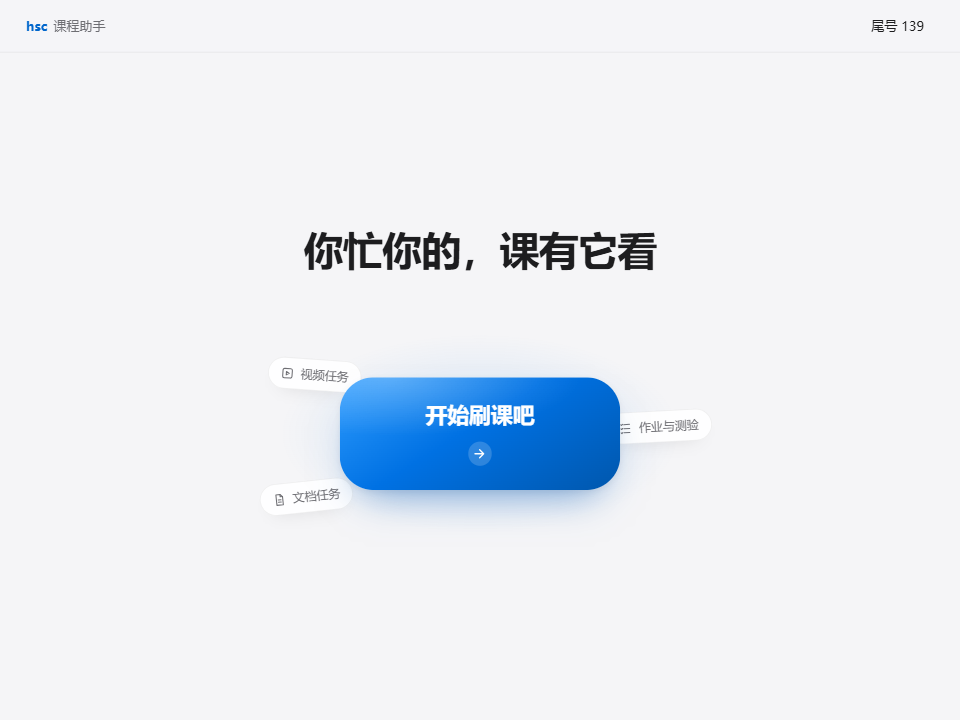
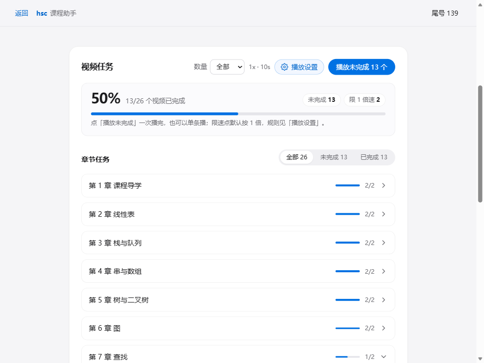
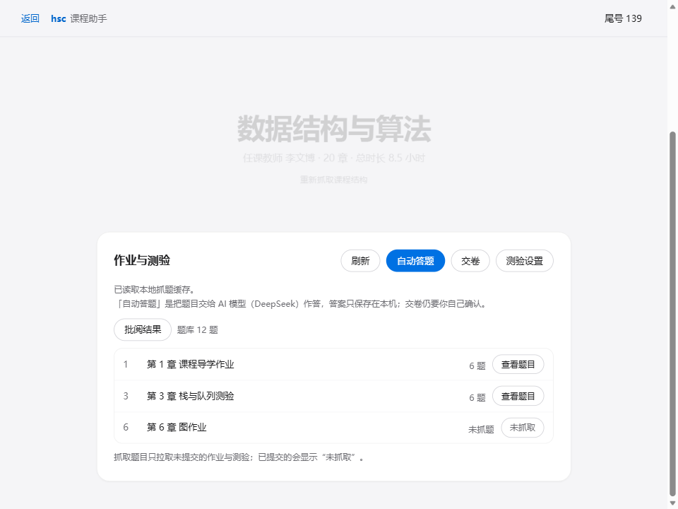
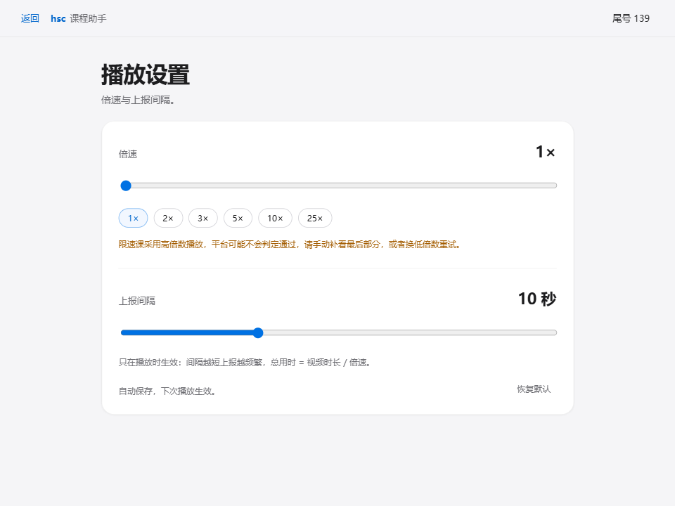
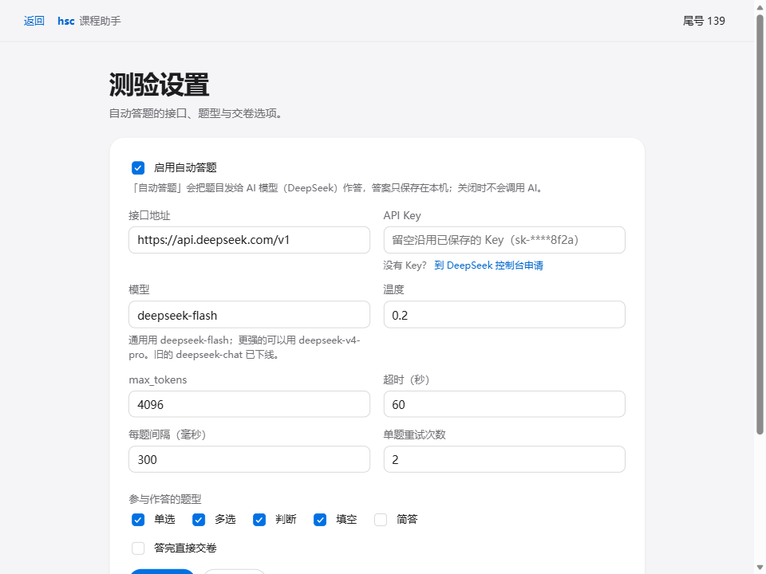

# hsc 课程助手（GUI）

hsc 课程助手是 [hust-smartcourse-cli](https://github.com/xcdoge/hust-smartcourse-cli)
的 Windows 图形界面。刷课、文档任务、作业测验和自动答题都收进一个单文件 exe，
不用记命令行参数，也不用手动拼链接。

- 产物：`hsc-gui.exe`，单文件（约 13 MB），前端资源打包在内，不需要另外装运行时
- 平台：Windows 10 / 11（依赖系统自带的 WebView2）
- 当前版本：**1.0.0-beta**
- 和 hust-smartcourse-cli 共用同一份 `state/`：命令行登录过，GUI 直接能用，反过来也一样

## 界面

| 首页 | 视频任务 |
| --- | --- |
|  |  |

| 作业与测验 | 播放设置 |
| --- | --- |
|  |  |

| 测验设置 |
| --- |
|  |

## 能做什么

- **登录**：扫码或账号密码；登录态失效自动回登录页
- **课程**：一次列出全部课程，点任意一行即加载课程结构
- **视频任务**：按章节折叠，一键播未完成或单条播；倍速 1–25、上报间隔 1–30 秒可调；
  单个任务点没过会标红「失败」，一轮结束给通过 / 失败统计并发系统通知
- **文档任务**：扫描全部文档，一键完成未完成文档，结果按服务器确认的数量报告
- **作业与测验**：自动扫描附件、抓取题目、自动答题、二次确认后交卷、查看批阅结果和题库
- **自动答题**：把题目交给 AI 模型（默认 DeepSeek `deepseek-flash`）作答，答案只保存在本机；
  会自动交卷的选项默认关闭
- **双构建**：release 版只显示必要信息；debug 版多一个调试面板，并把调用明细写进
  `state/logs/gui-debug-YYYYMMDD.log`

## 下载与运行

1. 到 [Releases](https://github.com/zheyu-U/HSC-GUI/releases) 下载最新的 `hsc-gui.exe`
2. 放进一个单独的文件夹再双击运行——`state/` 会生成在 exe 旁边，换文件夹等于换一份数据
3. 首页点「开始刷课吧」→ 扫码登录 → 选课
4. 课程页三块当标签页用：视频任务 / 文档任务 / 作业与测验

要用自动答题，先在「测验设置」里勾上「启用自动答题」并填 DeepSeek 的 API Key：
Key 到 <https://platform.deepseek.com/api_keys> 申请，接口地址和模型已经预填好，
只想用通用模型就保持 `deepseek-flash`。

## 真实分发测试（1.0.0-beta）

发布前按「刚拿到软件的人」走了一遍完整流程：新文件夹、空 `state/`、真实账号、真实课程。

- 环境：Windows 11 + WebView2，release 版 exe 直接双击
- 自动答题：DeepSeek `deepseek-flash`，温度 0.2，题型为单选 / 多选 / 判断 / 填空

| 环节 | 结果 |
| --- | --- |
| 首次启动 | 空目录自动生成 `state/`，首页和登录页正常 |
| 扫码登录 | 成功，写入 `state/auth/cookies.json` |
| 课程列表 | 12 门课程一次全部列出，无分页 |
| 打开课程 | 抓取结构：53 章 / 49 个视频 / 49 篇文档 / 50 份作业测验 |
| 视频播放 | 播放、停止、进度条、上报都正常，跑到第 3 个视频时手动停止（通过 3/49）。中间有一次 25 倍速上报被平台连续判不过，界面标红「失败」并提示重试，停止后按钮恢复可用 |
| 文档任务 | 扫描 49 篇，点「完成未完成文档」后 49/49（100%）完成，结果取自服务器日志（完成 49，跳过 0，失败 0） |
| 作业与测验 | 进块自动扫描并抓题：50 份 / 230 题 |
| 自动答题 | 228/230 题作答成功（Unit 3 单元检测题里有 2 题模型没给出答案，交卷时按未作答提交），题库累计 228 条 |
| 交卷 | 50 份全部提交成功，失败 0（服务器日志：提交完成：成功 50，跳过 0，失败 0） |
| 批阅结果 | 50 份全部显示「已批阅」 |

这一轮顺带验证过的修复：

- 文档完成结果改读本次服务器日志的 `完成 X，跳过 Y，失败 Z`，平台不回写 `isPassed` 时不会误报失败
- 自动答题默认走 DeepSeek 接口与 `deepseek-flash`（旧的 `deepseek-chat` 已下线）；
  没启用或没填 Key 时直接跳「测验设置」并说明原因，不弹确认框
- 交卷必须二次确认，结果按服务器返回的份数统计
- 播放设置里的倍速和上报间隔立即生效；单条视频没过会标红「失败」，一轮结束按失败数给结论
- debug 版把每次上报的明细写进 `state/logs/gui-debug-YYYYMMDD.log`，排查「多次上报仍未通过」时能直接对照

没覆盖到的：

- 视频只跑到 3/49 就手动停了，整门课刷完的判定回归没做
- 平台对文档、测验的状态回写有延迟，重新扫描后以平台显示为准
- 批阅分数要自己去平台看，GUI 只列「已批阅 / 未批阅」

## 从源码构建

需要 Go（本机 1.27.3）、Node.js、[Wails CLI](https://wails.io) v2.17.1。

```bash
# release 单文件 exe -> build/bin/hsc-gui.exe
wails build

# debug 版：多调试面板，并写 state/logs/gui-debug-YYYYMMDD.log
wails build -tags debug -o hsc-gui-debug.exe

# 后端与前端检查
go build ./... && go vet ./... && go test ./...
go build -tags debug ./... && go vet -tags debug ./...
cd frontend && npm.cmd install && npm.cmd run build

# 同步上游 vendor 代码（本机禁止直接跑 .ps1，要绕过执行策略）
powershell.exe -NoProfile -ExecutionPolicy Bypass -File scripts\sync-upstream.ps1
```

## 和上游的关系

本仓库只做编排和展示，不 fork 业务逻辑：协议细节（CAS 登录、播放签名、交卷端点、限速判断）
全部留在上游代码里，以功能白名单的方式 vendor 到 `internal/hsc/`，GUI 适配集中在
`internal/hsc/gui.go` 等新文件。上游更新后重跑同步脚本，适配文件不受影响。
`state/` 布局、加密凭据格式与 hust-smartcourse 命令行完全一致。

工程约定、页面结构、构建与提交规范都写在 [AGENTS.md](AGENTS.md)，
前后端绑定清单在 [docs/api.md](docs/api.md)。

## 边界与声明

- 不加：绕过平台风控的新手段、批量账号操作、分享答案的功能
- 唯一的例外是播放设置允许限速课按自设倍速播：平台可能不判定通过，需要手动补看最后一段或降速重试；
  这条风险只在播放设置页提示，不做二次确认
- 仅供个人学习使用。账号安全和使用后果由使用者自己承担，
  不要把账号或 API Key 交给别人，也不要在公共电脑上勾「记住账号」

## 数据放在哪

`state/` 全部在本机 exe 旁边：`auth/` 登录 cookie 与加密凭据、`course/` 课程与扫描缓存、
`quiz/` 题目、答案和题库、`config.toml` 测验设置。release 版不写日志文件；
debug 版只记接口调用与播放明细，不记密码、cookie、API Key 和验证码识别结果。
