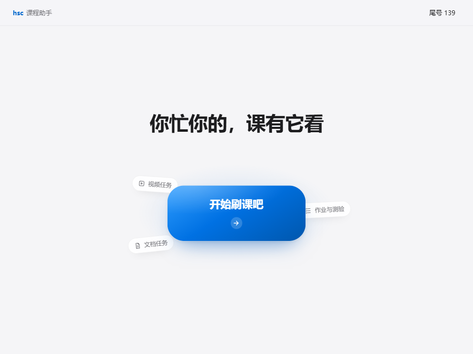
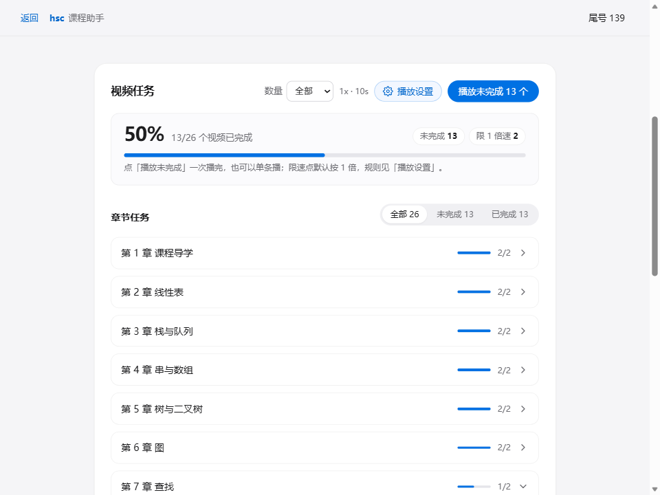

# hsc 课程助手 v1.0.0-beta

[hust-smartcourse-cli](https://github.com/xcdoge/hust-smartcourse-cli) 的 Windows 桌面图形界面，
**首个公开测试版**。刷课、文档任务、作业测验和自动答题都收进一个单文件 exe，
不用记命令行参数，登录态和缓存与 hust-smartcourse 命令行完全通用。

> 这是 beta：核心流程已在真实账号上跑通，但只做过 Windows 验证，细节可能还会调整。
> 遇到问题请开 issue，带上版本号和现象，别贴账号、cookie 或 API Key。

## 下载

| 文件 | 说明 | 大小 | SHA-256 |
| --- | --- | --- | --- |
| `hsc-gui.exe` | 正式版，只显示必要信息 | 13,297,152 字节 | `99b82cb806decf5e2e61d7bdcddaa7eafd0eb9817a51a4007b11ea04a0fca30c6` |
| `hsc-gui-debug.exe` | 调试版，多调试面板与 `state/logs` 明细日志 | 13,404,672 字节 | `d9319f3dc4e3eb501eb794159131ffed1dc6f409008c43b757ead7a41453dfcf` |

- 系统要求：Windows 10 / 11，依赖系统自带的 WebView2（Win11 自带，Win10 一般也有）
- 免安装：单文件，把 exe 放进一个空文件夹再运行，`state/` 会生成在它旁边；换文件夹等于换一份数据
- 升级：直接替换 exe，`state/` 不用动；与命令行版共用同一份数据

## 这一版能做什么

- **登录**：扫码或账号密码，登录态失效时自动回登录页
- **课程**：整页列出全部课程，点一行就加载课程结构；也可以粘贴课程链接进入
- **视频任务**：按章节折叠，一键播未完成或单条播放；倍速 1–25、上报间隔 1–30 秒可调；
  某个任务点没过会标红「失败」，一轮结束给通过/失败统计并发系统通知
- **文档任务**：扫描全部文档，一键完成未完成文档；结果按服务器确认的数量报告
- **作业与测验**：自动扫描附件、抓取题目、自动答题、二次确认后交卷、查看批阅结果与题库
- **自动答题**：把题目交给 AI 模型（默认 DeepSeek `deepseek-flash`）作答，答案只保存在本机；
  没启用或没填 Key 时会直接跳到测验设置说明怎么配
- **播放设置 / 测验设置**：两个独立设置页，改完立即生效
- **debug 版**：多一个调试面板，并把调用与播放明细写进 `state/logs/gui-debug-YYYYMMDD.log`
  （不记密码、cookie、API Key 和验证码识别结果）

## 真实分发测试

发布前按「刚拿到软件的人」走了一遍完整流程：新文件夹、空 `state/`、真实账号、真实课程，
自动答题用 DeepSeek `deepseek-flash`。

| 环节 | 结果 |
| --- | --- |
| 首次启动 | 空目录自动生成 `state/`，首页与登录页正常 |
| 扫码登录 | 成功，写入 `state/auth/cookies.json` |
| 课程列表 | 12 门课程一次全部列出，无分页 |
| 打开课程 | 53 章 / 49 个视频 / 49 篇文档 / 50 份作业测验 |
| 视频播放 | 播放、停止、进度条、上报正常；跑到第 3 个视频手动停止（通过 3/49），一次 25 倍速上报被连续判不过，界面标红「失败」并提示重试 |
| 文档任务 | 扫描 49 篇，点「完成未完成文档」后 49/49（100%）完成 |
| 作业与测验 | 进块自动扫描并抓题：50 份 / 230 题 |
| 自动答题 | 228/230 题作答成功（Unit 3 单元检测题里 2 题模型未给答案，交卷时按未作答提交），题库累计 228 条 |
| 交卷 | 50 份全部提交成功，失败 0 |
| 批阅结果 | 50 份全部显示「已批阅」 |

没覆盖的：视频只跑到 3/49，整门课刷完的判定回归没做；平台对文档、测验的状态回写有延迟；
批阅分数要自己去平台看。

## 已知问题

- beta 只在 Windows 11 + WebView2 上做过完整验证
- 平台有时不回写文档完成状态，界面以服务器日志为准；重新扫描后以平台显示为准
- 高倍速（尤其 25 倍）下平台可能连续判定不通过，建议降到 2–5 倍
- 自动答题需要自备 DeepSeek API Key：到 <https://platform.deepseek.com/api_keys> 申请，
  设置页已预填接口地址与模型
- 批阅结果只显示「已批阅 / 未批阅」，分数请到平台查看

## 使用提示与边界

- 播放设置允许限速课按自设倍速播，平台可能不判定通过：需要手动补看最后一段，或降低倍速重试；
  风险只在播放设置页提示，不做二次确认
- 二进制与 `state/` 都在本机，release 版不写日志文件；账号安全由使用者自己负责，
  不要把账号或 API Key 交给别人，也不要在公共电脑上勾「记住账号」
- 仅供个人学习使用，不加绕过平台风控、批量账号操作、分享答案的功能

## 完整变更

首次发布，提交范围：<https://github.com/zheyu-U/HSC-GUI/compare/f5c9cd5...v1.0.0-beta>

工程说明见 [AGENTS.md](AGENTS.md)，接口清单见 [docs/api.md](docs/api.md)。
